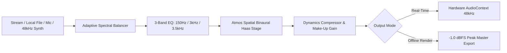

<div align="center">

<!-- Animated Typing SVG Header -->
<a href="https://hexsleuth.github.io/HexRadio-Enhancer/">
  
</a>

<p align="center">
  <strong>Zero-Backend, Client-Side Real-Time Audio Enhancer, Worldwide Radio Hub & Offline Track Masterer</strong>
</p>

<!-- Real-Time Dynamic GitHub & Web Badges -->
<p align="center">
  <a href="https://hexsleuth.github.io/HexRadio-Enhancer/">
    
  </a>
  <a href="https://github.com/hexsleuth/HexRadio-Enhancer/stargazers">
    
  </a>
  <a href="https://github.com/hexsleuth/HexRadio-Enhancer/network/members">
    
  </a>
  <a href="https://github.com/hexsleuth/HexRadio-Enhancer/commits">
    
  </a>
  
  
</p>

<!-- Animated Soundwave Divider -->


<p align="center">
  <a href="https://hexsleuth.github.io/HexRadio-Enhancer/"><strong>🚀 Launch Live Web App</strong></a>
  ·
  <a href="#-core-capabilities"><strong>🎛️ Features</strong></a>
  ·
  <a href="#-dsp-signal-chain"><strong>🔊 DSP Signal Chain</strong></a>
  ·
  <a href="#-local-deployment"><strong>💻 Self-Host</strong></a>
</p>

</div>

---

## 📱 Mobile-First & Responsive Studio Interface

**HexRadio-Enhancer** (powered by **HexAudio & AtmosForge Studio**) is engineered from the ground up with a touch-friendly, responsive layout that adapts seamlessly across **smartphones, tablets, and ultra-wide desktop monitors**.

> **Zero Installation Required:** Runs natively in modern mobile & desktop browsers using hardware-accelerated Web Audio APIs with zero external server processing.

---

## ✨ Core Capabilities

<table>
  <tr>
    <td width="50%" valign="top">
      <h3>🌍 Worldwide Radio & Adaptive Streams</h3>
      <ul>
        <li><strong>30+ Country Filters:</strong> Instant access to stations across the US, UK, Germany, Japan, India, Brazil, France, and worldwide.</li>
        <li><strong>10+ Genre Presets:</strong> One-tap filtering for <em>Jazz, Lo-Fi, Classical, Electronic, Rock, News, Ambient, Pop, Hip-Hop,</em> and <em>Country</em>.</li>
        <li><strong>Multi-Protocol Engine:</strong> Auto-detects and plays <strong>HLS (<code>.m3u8</code>)</strong> via <code>HLS.js</code>, <strong>DASH (<code>.mpd</code>)</strong> via <code>Shaka Player</code>, and native 5.1 spatial streams.</li>
        <li><strong>Built-in Test Signals:</strong> Includes a <strong>48kHz Synth Reference</strong> generator and <strong>Live Mic Monitor</strong>.</li>
      </ul>
    </td>
    <td width="50%" valign="top">
      <h3>🎛️ Real-Time AtmosForge DSP</h3>
      <ul>
        <li><strong>3-Band Parametric EQ:</strong> Precision gain controls for <strong>Bass (150Hz)</strong>, <strong>Presence (3kHz)</strong>, and <strong>Treble (3.5kHz)</strong>.</li>
        <li><strong>Dolby Atmos Spatial DSP:</strong> Binaural Haas cross-feed & height-stage virtualization with adjustable <strong>Spatial Width (0–100%)</strong>.</li>
        <li><strong>Dynamic Mastering Compressor:</strong> Real-time Ratio, Threshold (dBFS), and Make-up gain staging.</li>
        <li><strong>Adaptive Spectral Balancing:</strong> Model-free, local real-time frequency balancing.</li>
      </ul>
    </td>
  </tr>
  <tr>
    <td width="50%" valign="top">
      <h3>🤖 AI Acoustic Tuner (No API Key)</h3>
      <ul>
        <li><strong>Natural Language Tuning:</strong> Describe your headphones, room acoustics, or mood (e.g., <em>"warm late-night jazz on open-backs"</em>).</li>
        <li><strong>5 Free AI Models + Fallback:</strong> Queries free inference endpoints and falls back seamlessly to built-in acoustic heuristics.</li>
        <li><strong>Instant Scene Curves:</strong> One-tap presets for <em>EDM Club, Podcast, Night Mode, Jazz Hall, Classical, Car Bass, Speech Boost,</em> and <em>Cinematic</em>.</li>
      </ul>
    </td>
    <td width="50%" valign="top">
      <h3>💿 Offline Track Converter & Masterer</h3>
      <ul>
        <li><strong>100% Client-Side Offline DSP:</strong> Process local files (<code>FLAC, WAV, MP3, OGG, Opus, M4A, WebM</code>) privately in-browser.</li>
        <li><strong>Studio Export Formats:</strong>
          <ul>
            <li><code>WAV</code> 16-bit & 24-bit Hi-Res / 48 kHz</li>
            <li><code>MP3</code> 320 kbps</li>
            <li><code>WebM / OGG Opus</code> 256 kbps</li>
            <li><code>M4A / AAC</code> 256 kbps</li>
          </ul>
        </li>
        <li><strong>Loudness Safety:</strong> Built-in <code>-1.0 dBFS</code> True Peak Normalization.</li>
      </ul>
    </td>
  </tr>
</table>

---

## 🔊 DSP Signal Chain Architecture



---

## 🎨 Dynamic Theme & Custom Color Engine

Personalize the studio workspace on any screen size with live theme switching and real-time CSS token overrides:

* **Built-in Corporate & Dark Studio Palettes**
* **Live Customizer:** Tweak `Primary`, `Secondary`, `Accent`, `Neutral`, `Base 100/200/300`, and `Base Content` colors on the fly with instant reset support.

---

## 📱 Mobile-Friendly Collapsible Guides

<details>
<summary><b>👆 Tap to view Quick-Start Guide (Mobile & Desktop)</b></summary>
<br>

1. **Open the Studio:** Navigate to [hexsleuth.github.io/HexRadio-Enhancer](https://hexsleuth.github.io/HexRadio-Enhancer/).
2. **Choose an Audio Source:**
   * Select a **Country** or **Genre** from the Worldwide Radio Directory, or
   * Paste a custom `.m3u8` (HLS) / `.mpd` (DASH) URL into the **Adaptive Stream Engine**, or
   * Load a local audio file in the **Local Track Converter & Masterer**.
3. **Engage the Enhancer:** Toggle **Enable Enhancer** and pick a preset (*Atmos Spatial*, *Studio*, *Bass*, *Voice*, etc.) or prompt the **AI Acoustic Tuner**.
4. **Master & Export (Optional):** Select your target bitrate/format, enable `-1.0 dBFS Peak Normalize`, and tap **Render & Download Master**.

</details>

<details>
<summary><b>🛠️ Tap to view Local Deployment & Self-Hosting</b></summary>
<br>

Because **HexRadio-Enhancer** is a pure client-side web application, you can host it anywhere with zero build steps:

```bash
# 1. Clone the repository
git clone https://github.com/hexsleuth/HexRadio-Enhancer.git

# 2. Navigate into the directory
cd HexRadio-Enhancer

# 3. Serve locally (e.g., using Python or any static server)
python3 -m http.server 8080
```

Then open `http://localhost:8080` on your desktop or via your local network IP on your mobile device.

</details>

---

## 🧰 Tech Stack & Standards

<p align="left">
  
  
  
  
  
</p>

---

<div align="center">

<!-- Animated Footer Wave -->


**Built with ❤️ for audiophiles, radio explorers, and mobile listeners.**  
[Launch HexRadio-Enhancer](https://hexsleuth.github.io/HexRadio-Enhancer/) · [Report an Issue](https://github.com/hexsleuth/HexRadio-Enhancer/issues)

</div>
